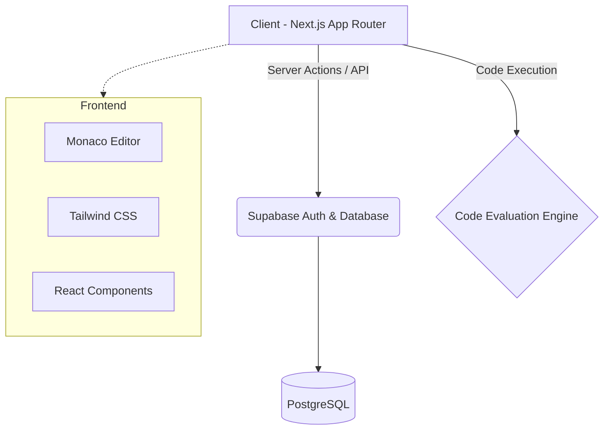

# 💻 Online Assessment Coding Platform


> A highly scalable, full-stack Online Coding Assessment Platform designed for hosting programming contests, assessing candidates, and practicing algorithmic problems.

---

## 📖 Table of Contents

- [About the Project](#-about-the-project)
- [Key Features](#-key-features)
- [System Architecture](#-system-architecture)
- [Tech Stack](#️-tech-stack)
- [Folder Structure](#-folder-structure)
- [Database Schema](#-database-schema)
- [Getting Started](#-getting-started)
- [Future Roadmap](#-future-roadmap)
- [Contributing](#-contributing)
- [License](#-license)

---

## 🚀 About the Project

This platform is engineered to provide a seamless competitive programming experience. It features an integrated in-browser IDE, real-time leaderboards, automated code evaluation (via specialized APIs), and a robust admin dashboard for creating dynamic programming contests.

Whether you're an organization looking to hire top talent through coding assessments or an educator hosting a coding bootcamp, this platform serves as a complete foundation.

---

## ✨ Key Features

### 👨‍💻 For Users (Candidates / Programmers)
- **Interactive Code Editor:** Embedded Monaco Editor (the core of VS Code) for syntax highlighting, autocomplete, and a native coding feel.
- **Problem Solving:** Browse a rich library of algorithmic problems categorized by difficulty and domain.
- **Live Contests:** Participate in time-bound coding competitions with a live countdown timer.
- **Global Leaderboard:** Track your ranking against peers in real-time.
- **Detailed Profiles:** View submission history, accuracy rates, and activity heatmaps.

### 🛡️ For Admins (Organizers)
- **Contest Management:** Create, schedule, and manage competitive events.
- **Problem Creation:** Author new algorithmic challenges with custom test cases.
- **Category Control:** Tag and categorize problems dynamically.
- **Analytics:** Monitor user performance and contest metrics.

---

## 🏗️ System Architecture



---

## 🛠️ Tech Stack

**Frontend Architecture:**
- **Next.js 15:** Utilizing the modern App Router for SSR, SSG, and optimized routing.
- **React 19:** Leveraging the latest concurrent features.
- **Tailwind CSS v4:** Utility-first styling with dynamic themes.
- **Lucide React:** Beautiful, consistent iconography.

**State & Editor:**
- **Monaco Editor React:** High-performance code editing interface.
- **Server Components:** Heavy lifting is done on the server, reducing the client bundle size.

**Backend & Database:**
- **Supabase:** Open-source Firebase alternative providing PostgreSQL database and authentication.
- **Supabase SSR:** Secure authentication flow across Server and Client components.

---

## 📁 Folder Structure

```text
├── src/
│   ├── app/                # Next.js App Router pages
│   │   ├── admin/          # Admin dashboard (Create problems/contests)
│   │   ├── contests/       # Active and past coding contests
│   │   ├── leaderboard/    # Global ranking pages
│   │   ├── login/          # Auth routes
│   │   ├── problems/       # Problem library and coding interface
│   │   ├── profile/        # User portfolio and stats
│   │   └── api/            # Backend API routes
│   │
│   ├── components/         # Reusable React components
│   │   ├── editor/         # Monaco editor wrapper
│   │   ├── layout/         # Navbar, Footer, ThemeProvider
│   │   ├── problems/       # Problem cards, filters
│   │   └── ui/             # Core UI elements (Buttons, Cards, Inputs)
│   │
│   ├── lib/                # Core utilities
│   │   ├── api/            # API wrappers for endpoints
│   │   └── supabase/       # Supabase client, server, and admin configs
│   │
│   └── types/              # TypeScript interfaces and type definitions
│
├── supabase/               # Database definitions
│   └── schema.sql          # PostgreSQL schemas, tables, and RLS policies
│
├── .env.example            # Environment variables template
└── tsconfig.json           # TypeScript configuration
```

---

## 🗄️ Database Schema

The core PostgreSQL schema includes the following primary entities:
- `users`: Managed via Supabase Auth.
- `profiles`: Extended user data (stats, avatars).
- `problems`: Algorithmic challenges and descriptions.
- `contests`: Scheduled events with start/end times.
- `submissions`: Records of user code, execution time, and verdict.
- `leaderboard`: Materialized view or table for fast ranking queries.

---

## 🚀 Getting Started

Follow these instructions to set up the project locally.

### Prerequisites
- Node.js 18+ (20+ recommended)
- A [Supabase](https://supabase.com/) account.

### 1. Clone the repository
```bash
git clone https://github.com/binarybrain-7/Online-Assessment-Coding-Platform.git
cd Online-Assessment-Coding-Platform
```

### 2. Install dependencies
```bash
npm install
```

### 3. Environment Setup
Create your local environment file:
```bash
cp .env.example .env.local
```
Update `.env.local` with your Supabase credentials:
```env
NEXT_PUBLIC_SUPABASE_URL=your-project-url
NEXT_PUBLIC_SUPABASE_ANON_KEY=your-anon-key
```

### 4. Database Setup
Navigate to the Supabase SQL editor in your project dashboard and execute the contents of `supabase/schema.sql` to generate the required tables and policies.

### 5. Start Development Server
```bash
npm run dev
```
Open [http://localhost:3000](http://localhost:3000) to view the application.

---

## 🗺️ Future Roadmap

- [ ] **Multi-language Support:** Add compilation support for Python, Java, C++, and Rust.
- [ ] **Real-time Collaboration:** Enable pair programming via WebSockets.
- [ ] **AI Code Assistant:** Integrate an LLM for providing hints on failed test cases.
- [ ] **Dockerized Evaluator:** Build a secure, sandboxed execution environment.

---

## 🤝 Contributing

Contributions, issues, and feature requests are welcome!
Feel free to check the [issues page](https://github.com/binarybrain-7/Online-Assessment-Coding-Platform/issues).

1. Fork the Project
2. Create your Feature Branch (`git checkout -b feature/AmazingFeature`)
3. Commit your Changes (`git commit -m 'Add some AmazingFeature'`)
4. Push to the Branch (`git push origin feature/AmazingFeature`)
5. Open a Pull Request

---

## 📝 License

Distributed under the MIT License. See `LICENSE` for more information.

---
*Built with ❤️ for developers, by developers.*